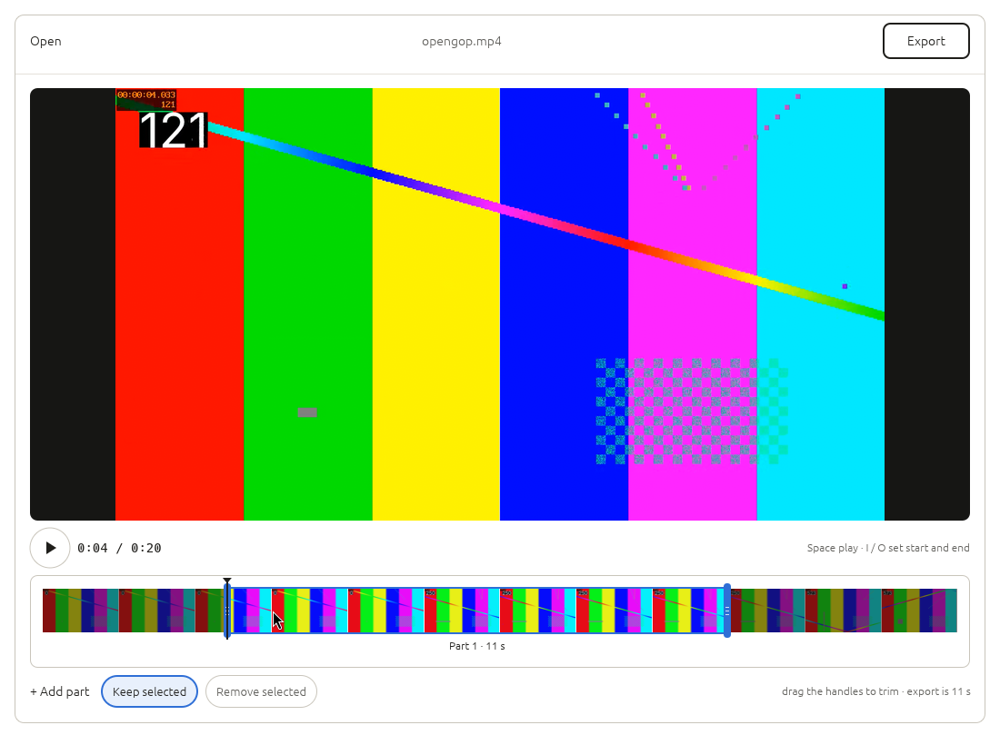

# Cutline

A simple video cutter for Linux, made for H.265 video. Open a file, drag two
handles, press **Export**. No settings needed.



## Using it

1. **Open.** Drop one or more videos on the window, use *Open with → Cutline*,
   or run `cutline clip.mp4`. It starts playing at once and the timeline fills
   with thumbnails. Several videos are laid end to end.
2. **Trim.** Drag the start and end handles, or press `I` and `O` while it
   plays. The preview follows the handle you're dragging, so you see the exact
   frame you're cutting on. *+ Add part* marks more parts; *Keep selected* /
   *Remove selected* decides whether the marked parts are what you keep or what
   you cut out.
3. **Export** (`Ctrl+E`). The dialog opens with *Original quality* selected, so
   Save finishes in seconds for most files and the result is saved next to the
   source as `<name> (cut).<ext>`.

The export dialog offers three plain choices:

| Choice | What it does |
| --- | --- |
| **Original quality** (default) | Copies the video without re-encoding. Only the few frames between each cut and the next keyframe are re-encoded, so cuts land on the exact frame. |
| **Fit to size** | Type a size in MB. Cutline shows a quality label and a time estimate before you save, and the file never comes out bigger than that size. |
| **Presets** | Named options: *Smaller file*, *Plays anywhere*, *For editing*, *Audio only*, plus your own. |

Codecs, resolution, frame rate and bitrate only appear in **Advanced…**, the
profile editor. A finished export's **Details** shows the exact ffmpeg
commands and the log.

**Safe by default:** an export writes into a hidden scratch folder and only
moves the finished file into place at the end, so Cancel (or a crash) never
leaves a broken file. Nothing is overwritten without asking (*Replace* or
*Keep both*), and the last session (videos, parts, playhead) comes back on
launch.

### Keys

| Key | Action |
| --- | --- |
| `Space` | Play / pause |
| `I` / `O` | Set the start / end of the part under the playhead (or start a new part) |
| `A` | Add a part at the playhead |
| `Delete` | Remove the selected part |
| `←` / `→` | One frame back / forward |
| `Shift+←` / `Shift+→` | One second back / forward |
| `Home` / `End` | Start / end of the timeline |
| `Ctrl+Z` / `Ctrl+Shift+Z` | Undo / redo |
| `Ctrl+O` / `Ctrl+E` | Open / Export |

Double-click an empty stretch of the timeline to add a part there. Right-click
it to remove a part, reorder videos or take one off the timeline.

## Installing

You need a Rust toolchain (1.80+) and, at run time, `ffmpeg`/`ffprobe` (6.0 or
newer for frame-exact Original quality cuts) and ideally `libmpv` (for smooth
preview with sound; without it the preview has no sound).

```bash
sudo apt install ffmpeg libmpv2        # Debian/Ubuntu
cargo build --release
install -Dm755 target/release/cutline ~/.local/bin/cutline
install -Dm644 packaging/cutline.desktop ~/.local/share/applications/cutline.desktop
```

`target/release/cutline-cli` is the same engine without a window:

```bash
cutline-cli probe clip.mp4
cutline-cli export clip.mp4 --keep 0:12-1:05 --keep 2:00-2:30          # Original quality
cutline-cli export clip.mp4 --keep 12-65 --profile fit --size 25       # Fit to 25 MB
cutline-cli export a.mp4 b.mp4 --keep 3-10 --keep 0-4@1 --separate     # @1 = second file
cutline-cli export clip.mp4 --keep 5-20 --plan                         # print the ffmpeg plan only
```

## How it works

```
cutline-gui (eframe/egui)      cutline-cli (clap)
        \                         /
         cutline-engine  ──  cutline-preview (libmpv via dlopen, thumbnails)
         planner (pure) · fit solver · estimates · job queue · stores
                |
         cutline-ffmpeg: locate, capabilities, ffprobe, typed commands, runner
                |
         cutline-core: timestamps, clips & parts, profiles (no IO)
```

* **cutline-core**: the data model. Timestamps are integer microseconds;
  parts never overlap; handles snap to whole frames.
* **cutline-ffmpeg**: finds ffmpeg/ffprobe, probes files, builds typed
  commands (the same text appears in Details) and runs them with progress and
  cancel.
* **cutline-engine**: the **planner** is a pure function from the request plus
  facts about the sources to the exact list of ffmpeg steps, so every decision
  is unit tested. The engine also holds the fit-to-size solver, the size and
  time estimates (refined by a 3-second sample encode), the background job
  queue, and the JSON stores for profiles and the session (XDG directories).
* **cutline-preview**: playback through libmpv's software renderer (loaded at
  run time, so Cutline starts without it), with an ffmpeg-only fallback, plus
  disk-cached timeline thumbnails.

### Frame-exact cuts without re-encoding

Copying can only start on a keyframe, so each part is built from up to three
pieces: the frames from the cut to the next keyframe are re-encoded with the
source's codec, size, pixel format and colours (no B-frames, capped near the
source bitrate); the packets between keyframes are copied untouched; the frames
from the last keyframe to the end cut are re-encoded again. Open-GOP leading
pictures (whose references are gone) are dropped with the `noise` bitstream
filter, parameter sets are repeated in-band, and `setts` keeps decode
timestamps increasing across each join. After muxing, Cutline decodes the
frames around every join. If any come out wrong (decode errors, frames out of
order, gaps), that video is converted at matching quality instead, so the cut
points you chose are always respected.

### Fit to size

The solver (`crates/cutline-engine/src/fit.rs`) holds back 3% for rate-control
error plus the container's own bytes, gives audio a share that shrinks as the
budget does, then picks the largest picture size (and full or half frame rate)
at which the remaining bitrate still looks good, against a reference bitrate
that scales with `pixels^0.75 · fps^0.6`. It encodes H.265 two-pass, checks the
real file, and re-runs the second pass at a corrected bitrate if it came out
over the target. When the size you type is at least what Original quality
would produce, it keeps the original instead.

## Development

```bash
cargo test --workspace    # unit tests + end-to-end exports (skipped without ffmpeg)
cargo clippy --workspace --all-targets
CUTLINE_NO_MPV=1 cargo run -p cutline-gui -- clip.mp4   # try the ffmpeg-only preview
```
